<div align="center">

# LiteTodo

**The to-do list that lives on the edge of your screen**

A frameless to-do widget for Windows with adjustable transparency. Drag it to a screen edge and it tucks away; touch the edge and it slides back.<br>
One exe of about 214 KB that runs on the .NET Framework 4.8 built into Windows. Nothing to install.

[简体中文](README.md) · English · [日本語](README.ja.md)

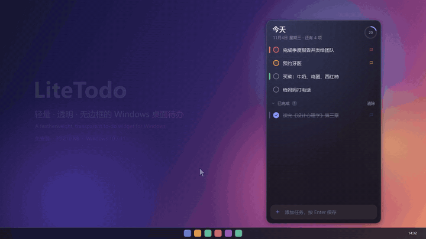

**[Download the latest release](https://github.com/wuyao4/LiteTodo/releases/latest)** · Full 47-second demo video: [`site/assets/demo.mp4`](site/assets/demo.mp4) · Website: [litetodo.wyyy.site](https://litetodo.wyyy.site)

</div>

> The app's interface is currently in Simplified Chinese. The screenshots and the demo show the real UI.

## Screenshots

<p align="center">
  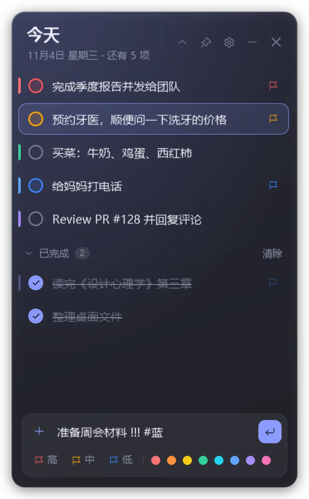
  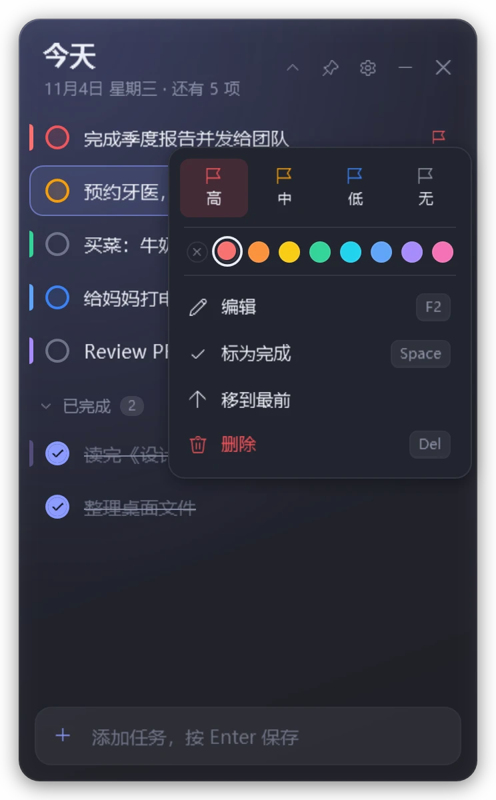
  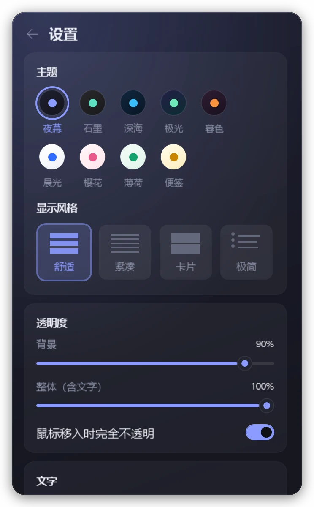
  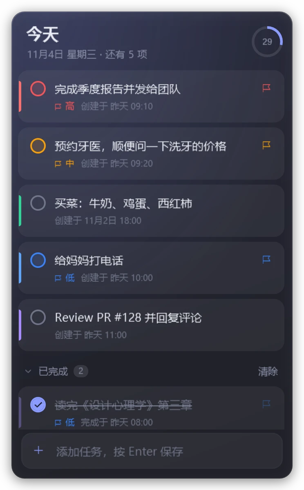
</p>
<p align="center">
  
  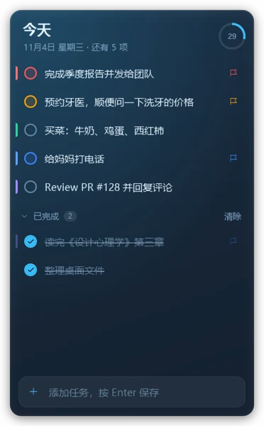
  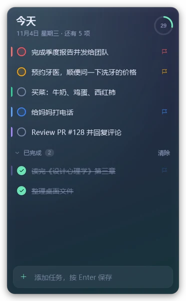
  
  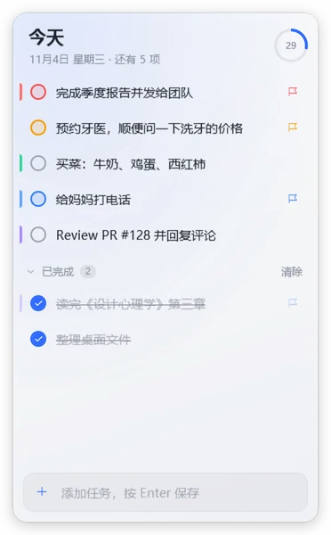
  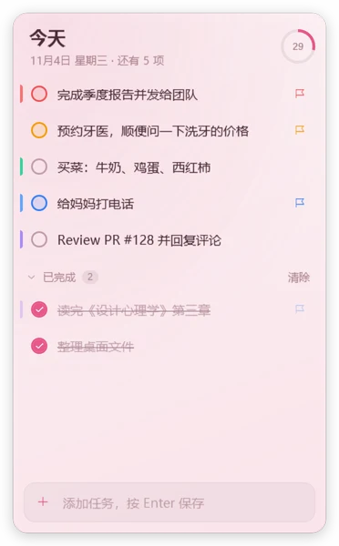
  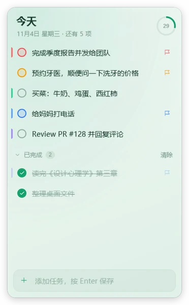
  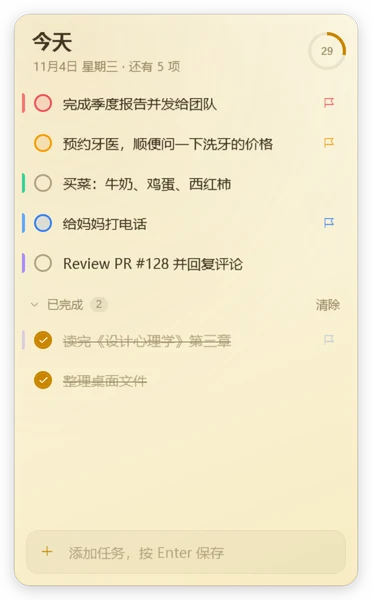
</p>

## Features

- **Edge docking**: drop the window on the left, right or top edge of the screen and it shrinks to a thin strip. Rest the mouse on that edge to slide it out; move away and it hides again. It stays on top while docked. The side with the taskbar and any side shared with another monitor never dock.
- **Two kinds of transparency**: background transparency fades only the backdrop and keeps text sharp; window transparency fades everything. Adjust it any time with `Ctrl` + scroll wheel, or let the window turn solid while the mouse is over it.
- **Fast input**: press Enter to add. Write `!`, `!!` or `!!!` for low, medium or high priority, and a color tag such as `#红` (red) or `#蓝` (blue). Paste several lines, or drag text in from another app, and each line becomes a task (list markers such as `-`, `1.` and `[ ]` are removed).
- **Completing and organizing**: click the circle to complete a task; it then slides into a collapsible Done group. Drag or press `Ctrl+↑/↓` to reorder, or sort by priority. Deleting can be undone.
- **Right-click menu**: priority, 8 color tags, edit, mark done, move to top, open a link found in the task, delete.
- **9 themes × 4 layouts**: Midnight, Graphite, Ocean, Aurora, Dusk, Daylight, Sakura, Mint, Paper; comfortable, compact, card (shows created and completed times) and minimal.
- **Fold mode**: double-click the title bar to fold the window into one line showing the title, your next task and progress.
- **Window layer**: always on top, normal, or always at the bottom (behind other windows, like a desktop widget).
- **Tray and hotkey**: `Ctrl+Alt+T` shows or hides the window from anywhere. The tray menu can create a task, pin the window or open settings, and its tooltip shows how many tasks are left. The window can be hidden from Alt+Tab.
- **Local data only**: one JSON file. No network, no account. A damaged file is backed up, never overwritten.

## Install and run

1. Download `LiteTodo-v1.2.zip` from [Releases](https://github.com/wuyao4/LiteTodo/releases/latest), unzip it and run `LiteTodo.exe`. You can also download `LiteTodo.exe` on its own.
   The exe isn't code-signed, so on first run Windows may show "Windows protected your PC". Click **More info → Run anyway**.
2. Requirements: Windows 10 1903 or later, or Windows 11 (both include .NET Framework 4.8).
3. The first run adds a few example tasks that walk through the main actions. Delete them when you're done; you can add them again from Settings.

**Portable mode**: put an empty file named `portable` next to the exe and the data (`todo-data.json`) is stored next to it.

## Keyboard shortcuts

| Action | Keys |
| --- | --- |
| Add a task | `Enter` |
| Priority of the new task (in the input box) | `Ctrl+1` / `Ctrl+2` / `Ctrl+3` / `Ctrl+0` (high / medium / low / none) |
| Select tasks | `↑` `↓` `Home` `End` (`↓` from an empty input box enters the list) |
| Complete / reopen | `Space` |
| Edit | `Enter` / `F2`, `Esc` to cancel, or double-click the text |
| Set priority | `1` `2` `3` `0` (high / medium / low / none) |
| Reorder | `Ctrl+↑` / `Ctrl+↓`, or drag |
| Delete / undo | `Del` / `Ctrl+Z` |
| Background transparency | `Ctrl` + scroll wheel |
| Font size | `Ctrl+=` / `Ctrl+-` |
| Settings | `Ctrl+,`, `Esc` to go back |
| Fold to the title bar | Double-click the title bar |
| Window menu | Right-click the title bar |
| Hide while docked | `Esc` |
| Show / hide the window | `Ctrl+Alt+T` (global) |

## Data

- Stored in `%APPDATA%\LiteTodo\todo-data.json` by default. It is plain JSON, so you can back it up or sync it directly.
- If the file can't be read, it is saved as a `.bak` copy instead of being overwritten.
- Error log: `error.log` in the same folder.
- Command line: `LiteTodo.exe --exit` asks the running instance to save and quit (useful for upgrades); `--autostart` starts without taking focus (used when starting with Windows).

## Build from source

Only the Roslyn compiler from Visual Studio 2022 Build Tools is needed (no .NET SDK):

```powershell
git clone https://github.com/wuyao4/LiteTodo.git
cd LiteTodo
.\build.ps1                 # writes dist\LiteTodo.exe
.\build.ps1 -Run            # build and run
.\build.ps1 -OutDir D:\tmp  # write to another folder
```

### Developer tools (`tools/snap`)

Renders the UI offscreen without showing a window, taking focus or touching real data:

```powershell
.\tools\snap\run.ps1 -Data some-data.json -Prefix demo   # screenshots
.\tools\snap\run.ps1 -Data some-data.json -Test          # interaction tests (56)
```

The demo video is recorded with it too: `Snap.exe <data.json> <output dir> --video demo.mp4` (requires `ffmpeg`). Every frame is the real interface rendered offscreen.

## Project layout

```
src/
  Program.cs                entry point, single instance per data file, --exit / --autostart, logging
  MainController.cs         window, appearance, settings page, fold mode, saving, tray, global hotkey
  MainController.Input.cs   button dispatch, keyboard, selection, completion animation, editing, drag reordering, menus, batch add, undo
  MainController.Dock.cs    edge docking, custom window dragging (magnetic snapping and hints), bottom layer
  MainVM.cs                 data, the two group views, quick-input parsing, settings (binding source)
  Models.cs                 TodoItem, Settings, JSON storage, first-run examples
  Themes.cs                 color themes and layouts
  Fx.cs                     animations and attached properties (enter, collapse, pop, progress ring)
  MainWindow.xaml           layout
  Styles.xaml               control styles
site/                       website at litetodo.wyyy.site (one HTML file plus images and the demo video)
tools/snap/                 screenshot, test and video tools
tools/make-icon.ps1         generates app.ico
```
