<div align="center">

# LiteTodo

**画面の端にしまえる、軽い ToDo リスト**

枠なしで透明度を調整できる Windows デスクトップ用 ToDo。画面の端までドラッグすると自動で隠れ、マウスを当てるとすっと出てきます。<br>
約 214 KB の exe ひとつ。Windows 標準の .NET Framework 4.8 で動くので、インストールは不要です。

[简体中文](README.md) · [English](README.en.md) · 日本語

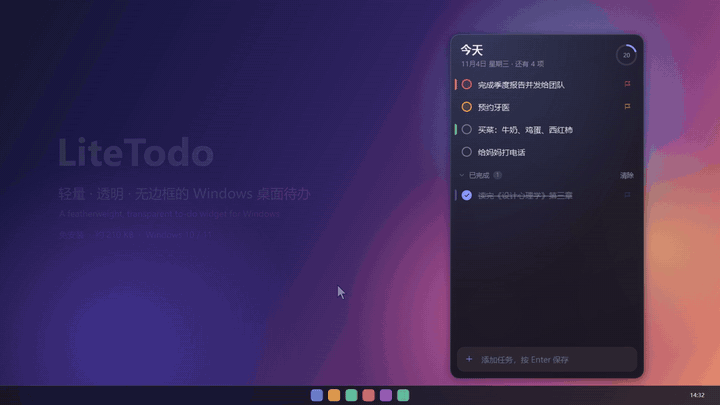

**[最新版をダウンロード](https://github.com/wuyao4/LiteTodo/releases/latest)** · 47 秒のフルデモ動画：[`site/assets/demo.mp4`](site/assets/demo.mp4) · ランディングページ：[`site/index.html`](site/index.html)

</div>

> アプリの画面表示は現在、簡体字中国語です。スクリーンショットとデモ動画は実際の画面です。

## スクリーンショット

<p align="center">
  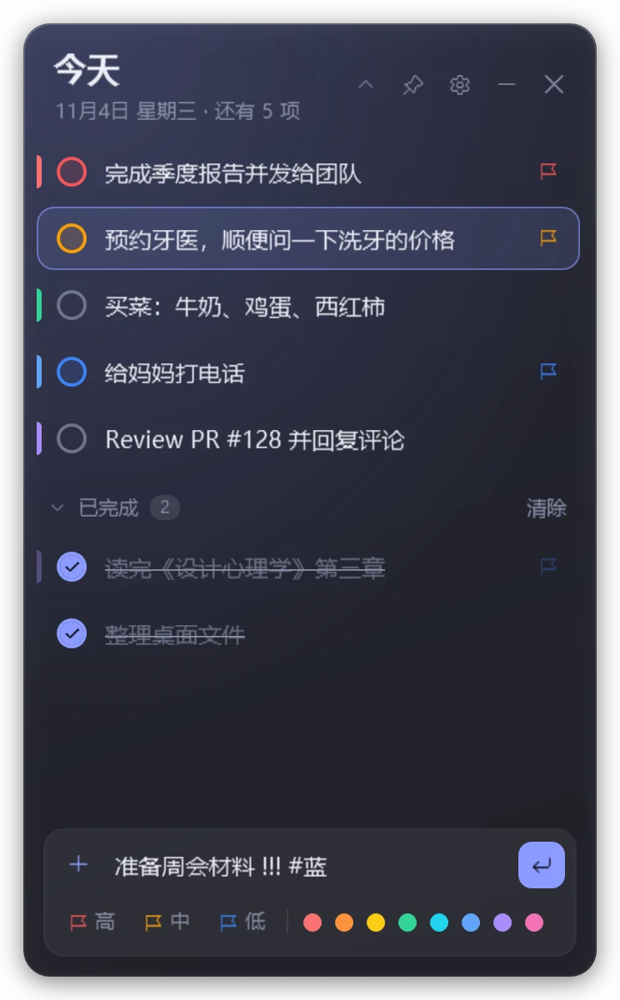
  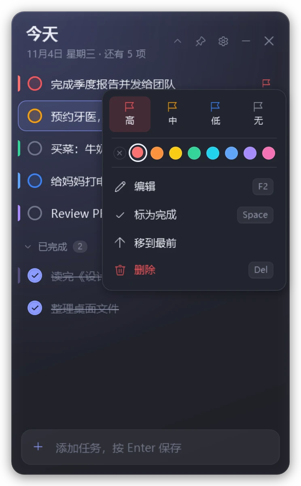
  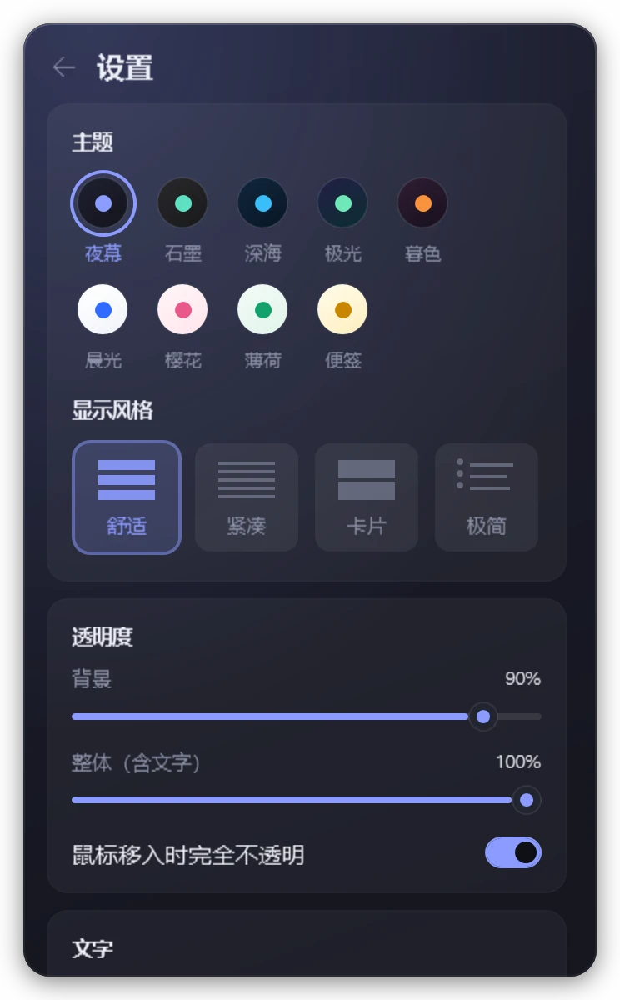
  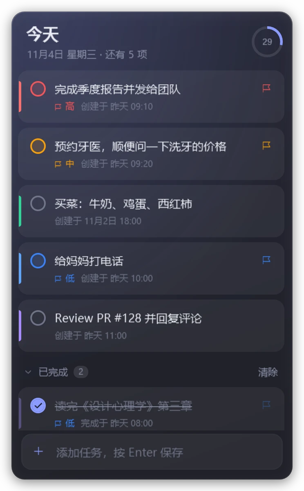
</p>
<p align="center">
  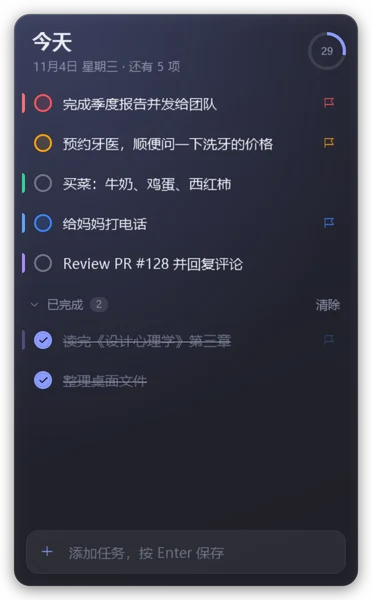
  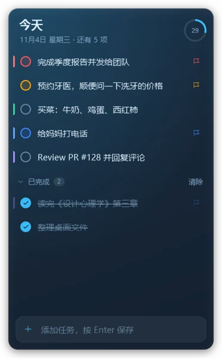
  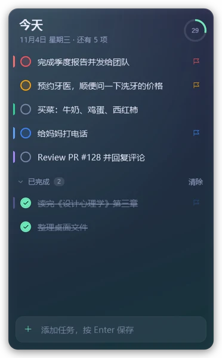
  
  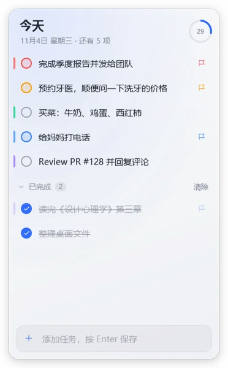
  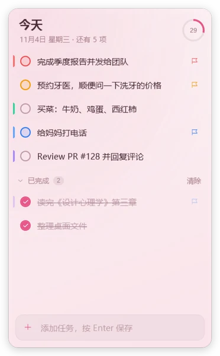
  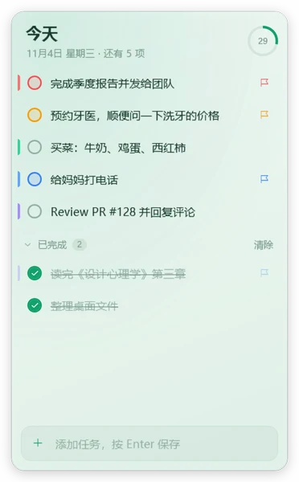
  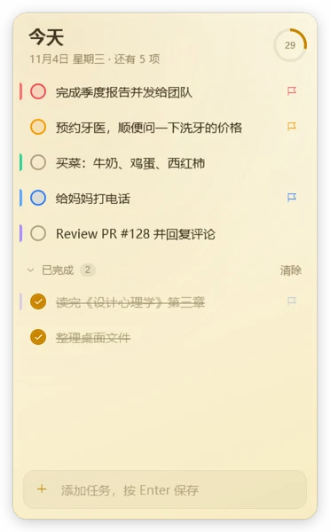
</p>

## 機能

- **画面の端にしまう**：ウィンドウを画面の左・右・上の端に置くと、細い線だけ残して隠れます。その端にマウスを少し置くと出てきて、離すとまた隠れます。しまっている間は常に最前面です。タスクバーのある側と、別のモニターと接している側にはしまいません。
- **2 種類の透明度**：背景の透明度は下地だけを薄くし、文字はくっきりのまま。ウィンドウ全体の透明度は文字ごと薄くします。`Ctrl` + マウスホイールでいつでも調整でき、マウスが乗っている間は不透明にすることもできます。
- **すばやい入力**：Enter で追加。`!` / `!!` / `!!!` で優先度 低 / 中 / 高、`#红`（赤）や `#蓝`（青）で色ラベル。複数行のテキストを貼り付けるか、他のアプリからテキストをドラッグすると 1 行ずつタスクになります（`-`、`1.`、`[ ]` などの記号は取り除きます）。
- **完了と整理**：丸をクリックすると完了し、少しして折りたためる「完了」グループへ移ります。ドラッグか `Ctrl+↑/↓` で並べ替え、優先度順の並べ替えもできます。削除は元に戻せます。
- **右クリックメニュー**：優先度、8 色の色ラベル、編集、完了にする、先頭へ移動、タスク内のリンクを開く、削除。
- **9 テーマ × 4 表示スタイル**：夜幕、石墨、深海、極光、夕暮、朝光、桜、ミント、付箋。ゆったり・コンパクト・カード（作成・完了時刻を表示）・ミニマル。
- **折りたたみ**：タイトルバーをダブルクリックすると、タイトル・次のタスク・進捗だけの 1 行になります。
- **ウィンドウの重なり順**：常に最前面 / 通常 / 常に最背面（他のウィンドウの下に置き、デスクトップウィジェットとして使えます）。
- **トレイとホットキー**：`Ctrl+Alt+T` でどこからでも表示 / 非表示。トレイメニューからタスクの新規作成、最前面の切り替え、設定を開けます。トレイのツールチップには残りの件数が出ます。Alt+Tab に表示しない設定もあります。
- **データはローカルのみ**：JSON ファイル 1 つ。通信もアカウントもありません。ファイルが壊れていた場合はバックアップを取り、上書きしません。

## インストールと起動

1. [Releases](https://github.com/wuyao4/LiteTodo/releases/latest) から `LiteTodo-v1.2.zip` をダウンロードして解凍し、`LiteTodo.exe` を実行します。`LiteTodo.exe` だけをダウンロードすることもできます。
   exe にはコード署名がないため、初回起動時に「Windows によって PC が保護されました」と表示されることがあります。「詳細情報 → 実行」をクリックしてください。
2. 動作環境：Windows 10 1903 以降、または Windows 11（どちらも .NET Framework 4.8 を搭載）。
3. 初回起動時には、主な操作を紹介するサンプルタスクがいくつか入っています。読み終えたら削除してください。設定からもう一度追加できます。

**ポータブルモード**：exe と同じフォルダーに `portable` という名前の空ファイルを置くと、データ（`todo-data.json`）も exe の隣に保存されます。

## キーボードショートカット

| 操作 | キー |
| --- | --- |
| タスクを追加 | `Enter` |
| 新しいタスクの優先度（入力欄で） | `Ctrl+1` / `Ctrl+2` / `Ctrl+3` / `Ctrl+0`（高 / 中 / 低 / なし） |
| タスクを選択 | `↑` `↓` `Home` `End`（空の入力欄で `↓` を押すとリストへ移動） |
| 完了 / 未完了に戻す | `Space` |
| 編集 | `Enter` / `F2`（`Esc` で取り消し）、または文字をダブルクリック |
| 優先度を設定 | `1` `2` `3` `0`（高 / 中 / 低 / なし） |
| 並べ替え | `Ctrl+↑` / `Ctrl+↓`、またはドラッグ |
| 削除 / 元に戻す | `Del` / `Ctrl+Z` |
| 背景の透明度 | `Ctrl` + マウスホイール |
| 文字サイズ | `Ctrl+=` / `Ctrl+-` |
| 設定 | `Ctrl+,`（`Esc` で戻る） |
| 1 行に折りたたむ | タイトルバーをダブルクリック |
| ウィンドウメニュー | タイトルバーを右クリック |
| 端にしまっているときに隠す | `Esc` |
| ウィンドウの表示 / 非表示 | `Ctrl+Alt+T`（どこからでも） |

## データ

- 既定では `%APPDATA%\LiteTodo\todo-data.json` に保存されます。普通の JSON なので、そのままバックアップや同期ができます。
- 読み込めなかった場合は `.bak` として残し、上書きしません。
- エラーログ：同じフォルダーの `error.log`。
- コマンドライン：`LiteTodo.exe --exit` で実行中のアプリを保存して終了させます（アップデート時に便利です）。`--autostart` はフォーカスを奪わずに起動します（Windows 起動時の自動起動で使用）。

## ソースからビルド

必要なのは Visual Studio 2022 Build Tools に含まれる Roslyn コンパイラーだけです（.NET SDK は不要）：

```powershell
git clone https://github.com/wuyao4/LiteTodo.git
cd LiteTodo
.\build.ps1                 # dist\LiteTodo.exe を出力
.\build.ps1 -Run            # ビルドして起動
.\build.ps1 -OutDir D:\tmp  # 別のフォルダーに出力
```

### 開発用ツール（`tools/snap`）

ウィンドウを表示せず、フォーカスも奪わず、実際のデータにも触れずに画面をオフスクリーンで描画します：

```powershell
.\tools\snap\run.ps1 -Data some-data.json -Prefix demo   # スクリーンショット
.\tools\snap\run.ps1 -Data some-data.json -Test          # 操作ロジックのテスト（56 項目）
```

デモ動画もこのツールで録画しています：`Snap.exe <data.json> <出力フォルダー> --video demo.mp4`（`ffmpeg` が必要）。どのフレームも、オフスクリーンで描画した実際の画面です。

## ソースの構成

```
src/
  Program.cs                エントリポイント、データファイルごとの単一インスタンス、--exit / --autostart、ログ
  MainController.cs         ウィンドウ、外観、設定画面、折りたたみ、保存、トレイ、グローバルホットキー
  MainController.Input.cs   ボタン処理、キーボード、選択、完了アニメーション、編集、ドラッグでの並べ替え、メニュー、一括追加、元に戻す
  MainController.Dock.cs    端にしまう処理、独自のウィンドウドラッグ（吸着とヒント）、最背面
  MainVM.cs                 データ、2 つのグループ表示、入力の解析、設定（バインディング元）
  Models.cs                 TodoItem、Settings、JSON 保存、初回のサンプル
  Themes.cs                 配色テーマと表示スタイル
  Fx.cs                     アニメーションと添付プロパティ（登場、折りたたみ、弾み、進捗リング）
  MainWindow.xaml           レイアウト
  Styles.xaml               コントロールのスタイル
site/                       ランディングページ（HTML 1 枚と画像・デモ動画）
tools/snap/                 スクリーンショット・テスト・動画用ツール
tools/make-icon.ps1         app.ico を生成
```
