<div align="center">

# LiteTodo

**贴在屏幕边缘的轻量待办清单**

无边框、可调透明度的 Windows 桌面待办。拖到屏幕边缘自动收起，鼠标一碰又滑出来。<br>
单个 exe，约 214 KB，使用系统自带的 .NET Framework 4.8，免安装。

简体中文 · [English](README.en.md) · [日本語](README.ja.md)

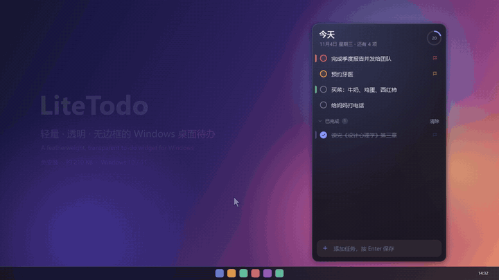

**[下载最新版](https://github.com/wuyao4/LiteTodo/releases/latest)** · 完整 47 秒演示视频：[`site/assets/demo.mp4`](site/assets/demo.mp4) · 官网页面：[`site/index.html`](site/index.html)

</div>

## 截图

<p align="center">
  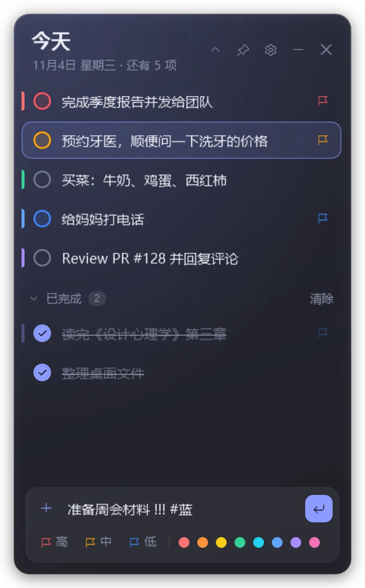
  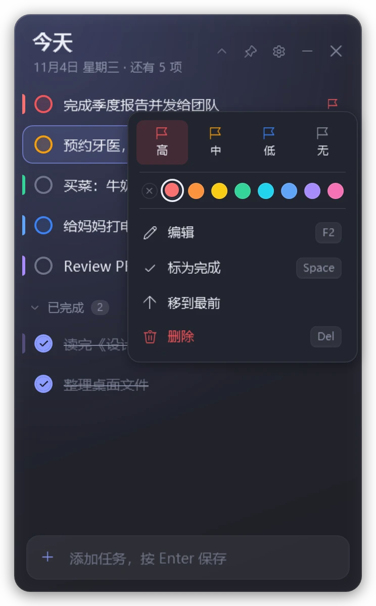
  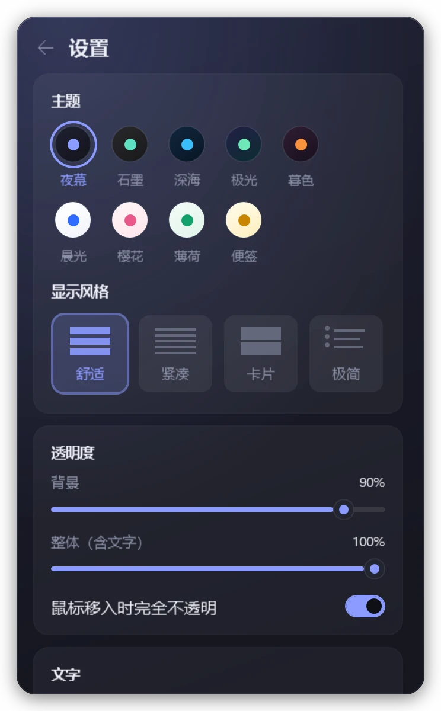
  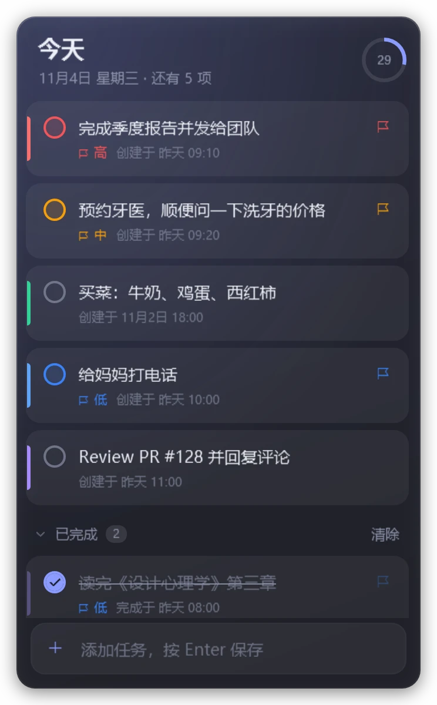
</p>
<p align="center">
  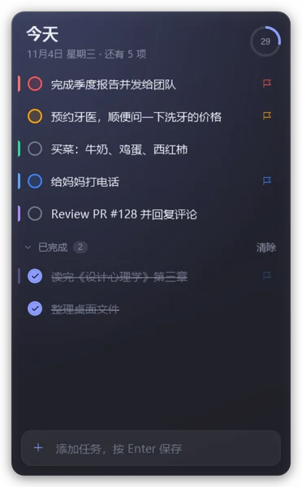
  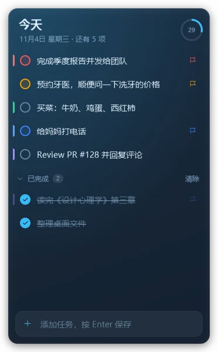
  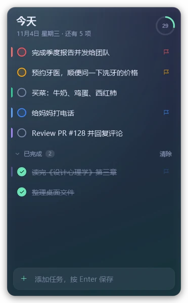
  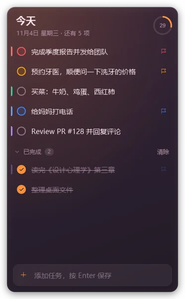
  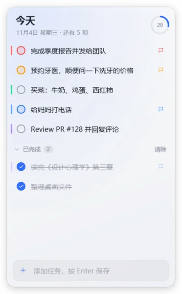
  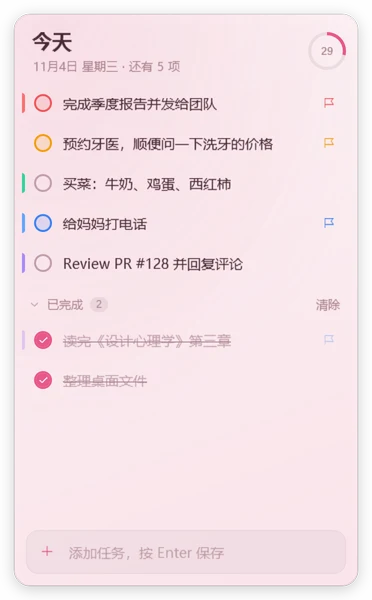
  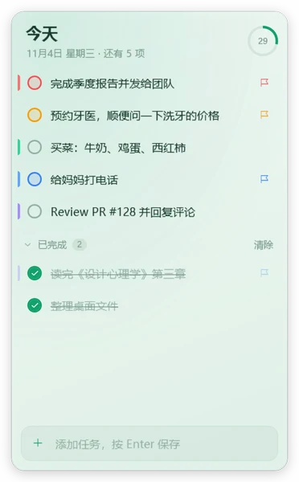
  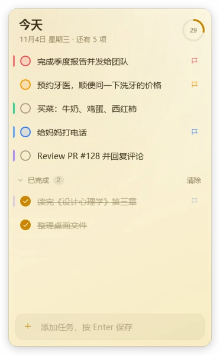
</p>

## 功能

- **贴边收起**：把窗口拖到屏幕左 / 右 / 上边缘，松手后收成一条细边；鼠标在边缘停一下就滑出来，移开后自动收回。收起期间始终置顶。任务栏所在的一侧和与其他显示器相邻的一侧不会收起。
- **两种透明度**：背景透明度只改底色，文字保持清晰；整体透明度连文字一起变淡。`Ctrl` + 滚轮随时调整，也可以设置成鼠标移入时完全不透明。
- **快速输入**：回车添加；开头或结尾写 `!` / `!!` / `!!!` 设为低 / 中 / 高优先级，写 `#红` `#蓝` 等加颜色标签；粘贴多行文字或从其他程序拖入文字，每行变成一项（自动去掉 `-`、`1.`、`[ ]` 等列表符号）。
- **完成与整理**：点圆圈完成，任务稍后滑入可折叠的「已完成」分组；拖动或 `Ctrl+↑/↓` 调整顺序；也可以按优先级排序。删除可以撤销。
- **右键菜单**：设置优先级和 8 种颜色标签、编辑、标为完成、移到最前、打开任务里的链接、删除。
- **9 种主题 × 4 种显示风格**：夜幕、石墨、深海、极光、暮色、晨光、樱花、薄荷、便签；舒适、紧凑、卡片（显示创建 / 完成时间）、极简。
- **折叠模式**：双击标题栏，窗口收成一条，只显示标题、下一项任务和完成进度。
- **窗口层级**：置顶 / 普通 / 置底（放在其他窗口下面，当桌面小部件用）。
- **托盘与热键**：`Ctrl+Alt+T` 随时显示 / 隐藏；托盘菜单可新建任务、置顶、打开设置；托盘提示显示剩余数量。可以设置不在 Alt+Tab 中显示。
- **数据只在本地**：一个 JSON 文件，不联网、无账号；损坏时自动备份，不会覆盖。

## 安装与运行

1. 从 [Releases](https://github.com/wuyao4/LiteTodo/releases/latest) 下载 `LiteTodo-v1.2.zip`，解压后运行 `LiteTodo.exe`；也可以只下载单独的 `LiteTodo.exe`。
   exe 没有代码签名，第一次运行如果出现「Windows 已保护你的电脑」，点「更多信息 → 仍要运行」。
2. 系统要求：Windows 10 1903 及以后 / Windows 11（自带 .NET Framework 4.8）。
3. 第一次运行会带几条示例任务，演示主要操作，看完删掉即可；之后也可以在「设置 → 添加使用示例」重新添加。

**便携模式**：在 exe 同目录放一个名为 `portable` 的空文件，数据就保存在 exe 旁边（`todo-data.json`）。

## 快捷键

| 操作 | 按键 |
| --- | --- |
| 添加任务 | `Enter` |
| 新任务的优先级（输入框中） | `Ctrl+1` / `Ctrl+2` / `Ctrl+3` / `Ctrl+0`（高 / 中 / 低 / 无） |
| 选择任务 | `↑` `↓` `Home` `End`（输入框为空时按 `↓` 进入列表） |
| 完成 / 取消完成 | `Space` |
| 编辑 | `Enter` / `F2`，`Esc` 取消；或双击文字 |
| 设置优先级 | `1` `2` `3` `0`（高 / 中 / 低 / 无） |
| 调整顺序 | `Ctrl+↑` / `Ctrl+↓`，或拖动 |
| 删除 / 撤销删除 | `Del` / `Ctrl+Z` |
| 背景透明度 | `Ctrl` + 滚轮 |
| 字号 | `Ctrl+=` / `Ctrl+-` |
| 设置 | `Ctrl+,`，`Esc` 返回 |
| 折叠为标题栏 | 双击标题栏 |
| 窗口菜单 | 右键标题栏 |
| 收起到边缘时隐藏 | `Esc` |
| 显示 / 隐藏窗口 | `Ctrl+Alt+T`（全局） |

## 数据

- 默认保存在 `%APPDATA%\LiteTodo\todo-data.json`，普通 JSON，可以直接备份或同步。
- 读取失败时会把原文件另存为 `.bak`，不会覆盖。
- 错误日志：同目录下的 `error.log`。
- 命令行：`LiteTodo.exe --exit` 让正在运行的实例保存并退出（升级时使用）；`--autostart` 启动时不抢焦点（开机自启使用）。

## 从源码构建

只需要 Visual Studio 2022 Build Tools 里的 Roslyn 编译器（不需要 .NET SDK）：

```powershell
git clone https://github.com/wuyao4/LiteTodo.git
cd LiteTodo
.\build.ps1                 # 输出 dist\LiteTodo.exe
.\build.ps1 -Run            # 构建并运行
.\build.ps1 -OutDir D:\tmp  # 输出到其他目录
```

### 开发工具（`tools/snap`）

离屏渲染界面，不显示窗口、不抢焦点、不碰真实数据：

```powershell
.\tools\snap\run.ps1 -Data some-data.json -Prefix demo   # 截图
.\tools\snap\run.ps1 -Data some-data.json -Test          # 交互逻辑测试（56 项）
```

演示视频也由它录制：`Snap.exe <data.json> <输出目录> --video demo.mp4`（需要 `ffmpeg`）。画面是应用逐帧离屏渲染的真实界面。

## 代码结构

```
src/
  Program.cs                入口、单实例（按数据文件区分）、--exit / --autostart、日志
  MainController.cs         窗口、外观、设置页、折叠、保存、托盘、全局热键
  MainController.Input.cs   按钮分发、键盘、选中、完成动画、编辑、拖动排序、菜单、批量添加、撤销
  MainController.Dock.cs    贴边收起、自定义拖动（磁吸 / 提示）、置底
  MainVM.cs                 数据、两个分组视图、快捷输入解析、设置（绑定源）
  Models.cs                 TodoItem、Settings、JSON 存储、首次运行示例
  Themes.cs                 主题配色与显示风格
  Fx.cs                     动画与附加属性（入场、收起、弹跳、进度环）
  MainWindow.xaml           界面布局
  Styles.xaml               控件样式
site/                       官网落地页（单个 HTML + 图片与演示视频）
tools/snap/                 截图、测试与视频录制工具
tools/make-icon.ps1         生成 app.ico
```
